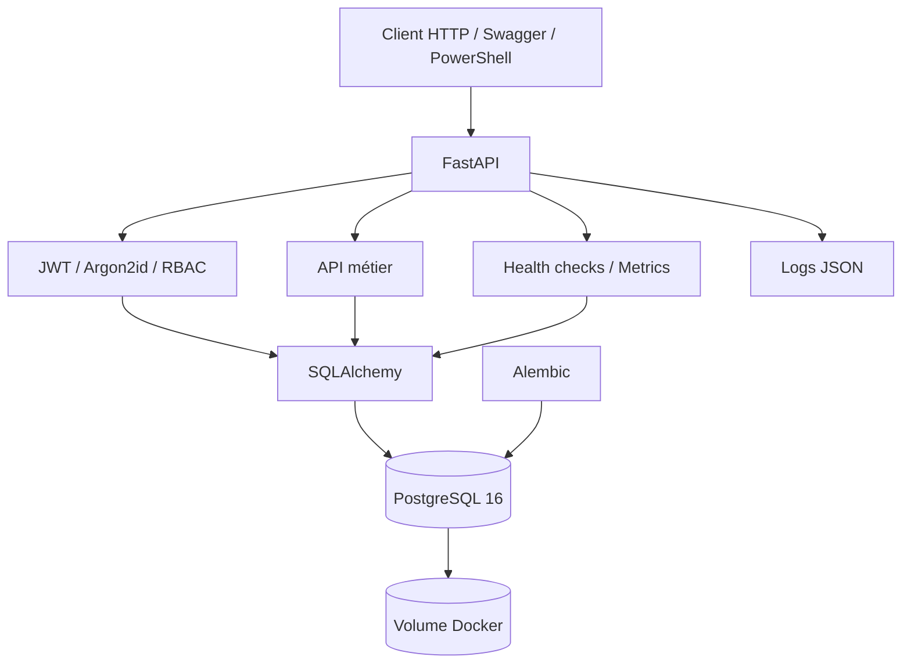

# Architecture du backend - v0.3.0

## Architecture actuelle

## Choix architecturaux

### Séparation des responsabilités

Le backend distingue les routes HTTP, les modèles
relationnels, les schémas de validation et les
composants techniques.

### Architecture stateless

L'API ne conserve aucune session utilisateur
en mémoire.

Les tokens JWT et les permissions enregistrées
dans PostgreSQL permettent la réplication future
du backend.

### Persistance

PostgreSQL est exécuté dans un conteneur Docker
associé à un volume persistant.

### Intégrité distribuée

Une contrainte d'exclusion PostgreSQL garantit
l'absence de réservations confirmées qui se
chevauchent sur une même salle.

### Observabilité

Les endpoints de santé permettent de préparer
les futures probes Kubernetes.

Les métriques Prometheus et les logs JSON
préparent la future plateforme de supervision.

## État de validation

56 tests automatisés réussis.

Les composants front-end, worker, stockage objet,
Kubernetes et Terraform ne sont pas encore
déployés à cette étape.
