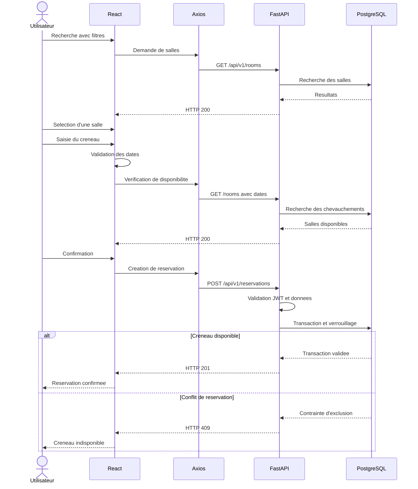

# Architecture du système de réservation

## 1. Diagramme de séquence

## 2. Responsabilites

### Frontend React

- Affichage des salles.
- Gestion des filtres.
- Validation ergonomique des formulaires.
- Conversion des dates au format UTC.
- Verification preliminaire de disponibilite.
- Affichage des confirmations et erreurs.

### Backend FastAPI

- Validation cryptographique du JWT.
- Identification de l'utilisateur.
- Validation des donnees.
- Verification des permissions.
- Gestion transactionnelle.
- Traduction des conflits en HTTP 409.

### PostgreSQL

- Persistance des reservations.
- Integrite referentielle.
- Contraintes de non-chevauchement.
- Atomicite des transactions.

## 3. Garanties

Une verification de disponibilite effectuee
par le frontend ne garantit pas la creation
ulterieure de la reservation.

La decision definitive appartient au backend
et a la base de donnees.

Cette separation permet de conserver
les garanties d'integrite meme avec
plusieurs clients simultanes.

La validation en environnement Kubernetes
multi-replicas reste a effectuer.

## 4. Evolutions

- Calendrier interactif.
- Historique des reservations.
- Annulation des reservations.
- Administration des salles.
- Stockage objet pour les photographies.
- Generation asynchrone de documents.
